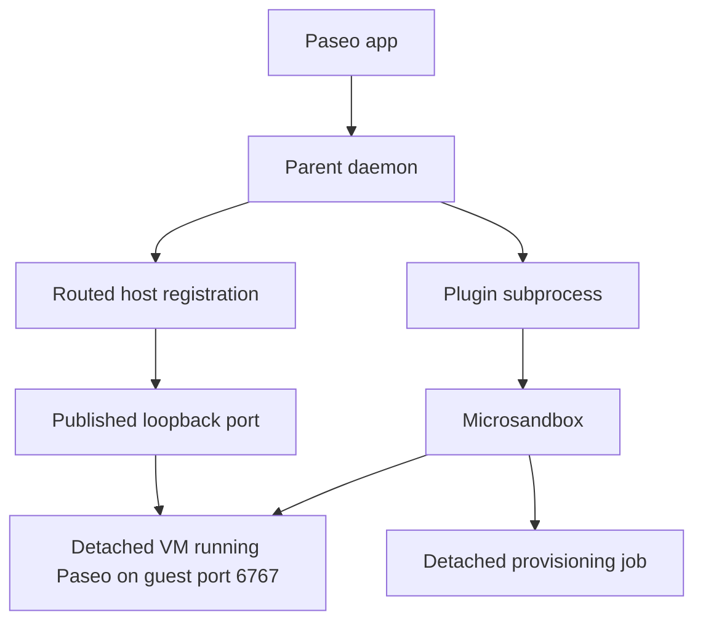
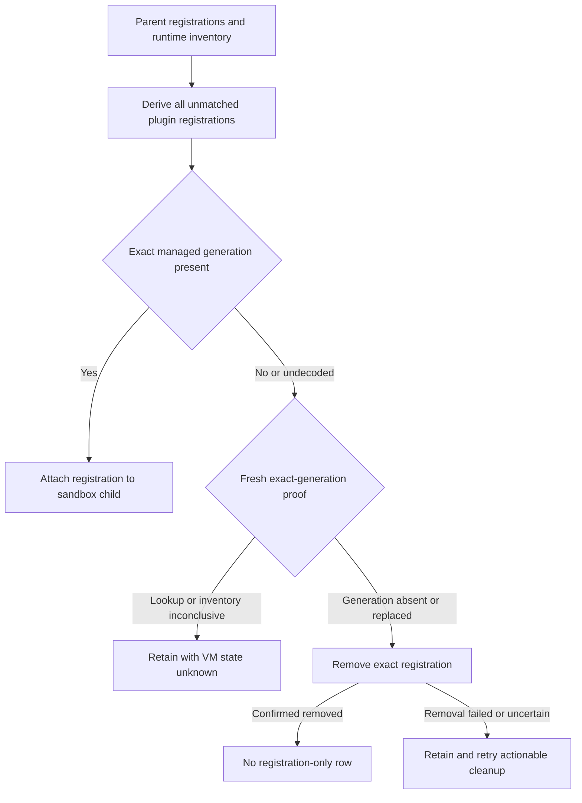

# paseo-msb: VM-backed Paseo hosts

`paseo-msb` is a Paseo parent-daemon plugin for creating and managing microsandbox VMs that run Paseo with selected agent providers. A managed VM appears in Paseo's normal host picker under the name chosen during creation. All lifecycle management happens in the plugin's Paseo UI, not through the `msb` CLI.

This V1.1 specification has two complementary parts:

1. **The user experience** follows the plugin screen through credentials, creation, inspection, resize, recovery, and deletion.
2. **The internal design** explains the identity model, reconciliation, ownership rules, security boundaries, and technical constraints behind that experience.

The first part describes what the user should see and be able to do. The second part is the implementation and verification contract; in particular, a simple UI must not imply weaker safety or recovery guarantees.

The ASCII mockups are structural rather than pixel-perfect. They follow the current two-pane/compact layout in `client/screen.tsx`, the Create flow in `client/CreateChild.tsx`, and the detail sheet in `client/ChildDetail.tsx`. Proposed additions are labelled explicitly: live metrics render today, while resource editing and the rolling metrics chart remain proposed.

## 1. The user experience

Throughout this document, a **child** is the user-facing unit managed by the plugin. Usually it is a managed VM plus its Paseo host registration. During creation or recovery it can also be a pending attempt without a VM, or a registration left behind after its VM disappeared.

### 1.1 Open the plugin screen

The plugin contributes one sidebar screen. Its main list combines:

- pending creates, including attempts that failed before allocating a VM;
- managed sandboxes, whether setup is in progress, ready, or failed; and
- unmatched registrations awaiting verification or cleanup.

The wide layout keeps the list and selected detail side by side. The compact layout shows either the list or one detail sheet, with a Back action.

```text
+------------------------------+---------------------------------------------+
| Child VMs 3     [Secrets] [+]| builder-1                [Repair] [Delete]  |
| +--------------------------+ | [Ready] [Online]                            |
| | builder-1                | |                                             |
| | [Ready] [Online]         | | Phase         Ready                         |
| +--------------------------+ | Runtime       Running                       |
| +--------------------------+ | Registration Online                         |
| | experiment               | | Setup         Claude (Anthropic), GitHub    |
| | [Installing] [Starting]  | | Stable ID     01J8...                       |
| +--------------------------+ |                                             |
| +--------------------------+ | > Logs (148 lines)                          |
| | failed-setup             | |                                             |
| | [Create failed] [No VM]  | |                                             |
| | Credentials missing      | |                                             |
| +--------------------------+ |                                             |
+------------------------------+---------------------------------------------+
```

Each row shows the child's name, setup health, VM status, and—when the V1.1 resource presentation is added—known RAM and root-disk size. A pending row shows its requested resources instead. Raw phase, runtime, registration state, and stable ID belong in the detail view; the row retains a short, safe error message when something is wrong.

The name is the create identity: at most one pending attempt is active per name, and a live sandbox with that name replaces an active pending row. A failed attempt stays visible beside a same-name sandbox or leftover registration-only child, so its failure can be retried or dismissed.

Loading, genuinely empty, partially unavailable, and failed inventory are distinct states. An unavailable inventory API must never look like an empty list or proof that a child is gone.

The screen refreshes while it is open, but it does not drive the work. Creating and provisioning continue in the background when the user closes the screen, reloads Paseo, or restarts the plugin or parent daemon. Registration cleanup also runs while the plugin server is active; closing the screen does not cancel it.

### 1.2 Manage credentials

The **Manage secrets** view supports six fixed credentials:

| Credential | Purpose |
| --- | --- |
| `ANTHROPIC_API_KEY` | Anthropic API access |
| `CLAUDE_CODE_OAUTH_TOKEN` | Claude subscription authentication |
| `OPENAI_API_KEY` | OpenAI API access |
| `GEMINI_API_KEY` | Gemini API access |
| `NEURALWATT_API_KEY` | NeuralWatt API access |
| `GH_TOKEN` | GitHub CLI integration |

The user can add or replace a stored value and remove a stored value. The UI never displays an existing value. It shows only which credentials are available and whether they come from the plugin's store, the parent process environment, or both. A stored value takes precedence over the environment.

These credentials determine which provider and integration options are available during Create. Create checks credential-store availability before opening or submitting and reports a store failure with a toast. The Create confirmation itself never accepts or displays a secret value.

### 1.3 Create a child

Create is a single confirmation flow with the following choices. This mockup mirrors the controls already present in `client/CreateChild.tsx`.

```text
+-- Create child ----------------------------------------------------------+
| Name         [paseo-018f4a............................]                 |
| RAM          [--------------o-----] 4096 MiB                            |
| Root disk    [----o-----------------] 10240 MiB   Growth only later     |
| CPUs         [2]                                                        |
| Image        <fixed verified image>                                     |
| Port         loopback -> guest 6767                                     |
|                                                                         |
| Providers (1)                                                           |
|   [x] Claude                                                            |
|       (x) Anthropic API key    ( ) Claude subscription                  |
|   [ ] Pi -- no supported credential available                           |
|                                                                         |
| Integrations (1)                                                        |
|   [x] GitHub CLI                                                        |
|                                                                         |
| Will install: Claude (Anthropic), GitHub CLI                            |
| Credentials: ANTHROPIC_API_KEY (stored), GH_TOKEN (environment)         |
|                                              [Cancel] [Create child]    |
+-------------------------------------------------------------------------+
```

#### Name

The name is optional in the form. If omitted, the plugin generates `paseo-<token>` with a short 10-character lowercase alphanumeric token for that attempt and shows it as the field placeholder; the generated name is submitted explicitly. A custom name must:

- be 1–63 characters;
- contain only lowercase ASCII letters, digits, and internal hyphens; and
- start and end with a letter or digit.

Whitespace, `/`, and path or URL punctuation are rejected. Names cannot be changed after creation. The name is the create identity: strict name allocation prevents two live children from claiming the same name, and a repeat with the same name joins only when its plan and resource shape match; otherwise the request fails rather than adopting or overwriting the existing child.

#### Resources

| Resource | Default | Allowed selection | Later changes |
| --- | --- | --- | --- |
| CPU | 2 | 1–16 CPUs | Fixed after Create |
| RAM | 4096 MiB | 1024–32768 MiB, in 256 MiB steps | Grow or shrink through **Edit resources** |
| Root disk | 10240 MiB | 1024–262144 MiB, in 1024 MiB steps | Grow only |

The image is fixed and shown for confirmation; V1.1 has no image picker.

#### Providers and integrations

The confirmation uses settings-style **Providers** and **Integrations** sections. Providers expose nested LLM options, unavailable options explain why they cannot be selected, and the confirmation lists the credential names derived from the selection.

- Every selected provider has at least one selected LLM option.
- Claude takes exactly one authentication option: Anthropic API key or Claude subscription.
- Pi takes one or more of Anthropic, OpenAI, Gemini, and NeuralWatt.
- The GitHub CLI integration requires `GH_TOKEN` and is independent of provider selection.

Only credentials required by the selected options enter the child. The plan contains identifiers, not credential values.

#### Submit and retry

Accepting Create closes the modal and immediately adds a pending child; setup continues in the background. Synchronous validation and credential errors stay in the modal. An asynchronous setup failure (for example `name_conflict`, `invalid_request`, or `delete_failed`) appears on the new pending child, which the user can retry or dismiss.

A failed pending create can be retried with its original name, resources, and plan. Retrying an existing sandbox joins its reconciliation instead of replaying setup or allocating another VM. **Dismiss** only removes an unwanted failed pending presentation; it never destroys a VM or registration.

### 1.4 Follow setup and recovery

Setup has four user-visible phases:

| Phase | Meaning |
| --- | --- |
| `creating` | Allocate the exact VM generation and its initial configuration. |
| `installing` | Run the idempotent provisioning job for the selected plan. |
| `registering` | Register the child with the parent, wait for routed online state, and verify selected providers. |
| `ready` | The child is available through Paseo's normal host UI. |

An error produces a failed presentation without erasing the next actionable phase. The user can inspect bounded logs and use Retry or Repair as appropriate. Provisioning failures preserve the VM, jobs, and registration for diagnosis and retry rather than deleting the evidence.

`deleting` is a cleanup phase, not a setup failure. Reloading during setup resumes reconciliation; reloading during deletion resumes cleanup, never setup.

After a child becomes ready, the plugin does not continuously monitor tool health, repair configuration drift, or re-provision it. Repair remains an explicit user action.

### 1.5 Open and use the child

A ready child appears under its chosen name in Paseo's normal host picker. There is no plugin-specific **Open Host** action and no connection-copy UI. The parent daemon routes the connection to the child, so the app does not need a separate direct network path to the VM.

### 1.6 Inspect details and logs

The child detail shows:

- the selected provider, LLM, and integration plan;
- current observed resources and, when different, requested resources awaiting convergence or restart;
- setup, runtime, and registration state;
- **Edit resources**, **Repair**, and **Delete** actions; and
- when a sandbox exists, one bounded, read-only log.

The V1.1 resource and metrics additions extend this existing detail sheet rather than adding another screen:

```text
+-- builder-1 -------------------------------------------------------------+
| [Ready] [Online]                                   [Repair] [Delete]     |
| Phase Ready   Runtime Running   Registration Online                      |
| Setup Claude (Anthropic), GitHub CLI                                     |
|                                                                         |
| Resources [V1.1]                                  [Edit resources]      |
|   Observed   2 CPUs   4096 MiB RAM   10240 MiB root disk                |
|   Requested  8192 MiB RAM -- restart required                           |
|                                                                         |
| Live metrics [V1.1]                                refreshes every 3 s  |
|   [rolling line chart: last 60 samples; gaps at discontinuities]        |
|   [hover updates the always-visible tooltip]                           |
|   tooltip: 14:32:03 UTC                                                 |
|     CPU 18%        Memory 1.7/4.0 GiB        Uptime 12m 41s             |
|     Disk read 1.2 MiB/s    Disk write 0.4 MiB/s                          |
|     Network RX 840 KiB/s   Network TX 96 KiB/s                            |
|   Root disk  [##########----------]  9.8 / 10.0 GiB (98%)               |
|                                                                         |
| > Logs (148 lines)                                                      |
+-------------------------------------------------------------------------+
```

The log is a collapsible monospace block containing chronological sandbox and provisioning entries with exact duplicates removed. Its header shows the line count, and timestamps appear in a separate column.

Raw microsandbox configuration, environment values, and secrets are never exposed in the detail.

### 1.7 Watch live metrics

While the detail of a running sandbox is visible, the metrics panel refreshes every 3 seconds. The chart plots:

- CPU utilization;
- memory used, scaled to the reported memory limit;
- disk read/write and network receive/transmit rates derived from consecutive samples.

Root-disk usage is not a chart series; it is shown by the usage bar below the chart. The tooltip also reports uptime and the exact values behind each series. It is always visible: hovering updates it to the nearest sample, and leaving the chart returns it to the latest sample.

The first sample has absolute values but no rates. Duplicate timestamps, including repeated stale timestamps, add no point; stale, future-dated, or discontinuous samples do not produce misleading rates. Metrics unavailability has a fixed, safe explanation and does not prevent the detail or logs from loading.

The chart is the primary presentation; there is no persistent numeric row grid. Hovering selects the nearest sample and updates the always-visible tooltip with its timestamp plus every reported series value. The same values are exposed through the chart's accessibility label/value and stepping actions, so exact readings are never hover-only. Unreported values are omitted or shown as `—`, never zero.

The chart is a bounded rolling view of the samples already received. It keeps at most the latest 60 samples—about three minutes at the 3-second cadence—in client memory for the selected generation and discards them when the selection changes, the detail closes, or metrics become unavailable. It is not persisted and requires no server API change.

Series are plotted independently, each scaled within its own unit family so unlike values are never added together:

- CPU is one line from `cpuPercent`;
- memory used is scaled to the reported limit;
- disk read and write rates are separate lines; and
- network receive and transmit rates are separate lines.

Missing or unreported values are gaps, never zeros. The first sample is a single point without a line, and a duplicate timestamp adds no point. A stale, future-dated, non-increasing, uptime-regressing, or counter-regressing sample starts a new segment, so the chart never connects across a discontinuity.

Near the chart, a root-disk usage bar shows the latest sample's writable upper-layer usage against its reported capacity: `upperUsedBytes / (upperUsedBytes + upperFreeBytes)`. It is a current-state indicator, not a time series, and adds no history. The bar is hidden when either field is null or the total is non-positive; it never renders a missing disk as zero. It carries a progressbar role and a text value so the reading does not depend on color or width alone.

Metrics are live and display-only; the chart is a bounded rolling view of samples already received, not stored history. V1.1 has no durable metrics history, general metrics screen, or alerting, and metrics never trigger repair, restart, or deletion.

### 1.8 Edit resources

**Edit resources** changes RAM and, when a safe observed baseline exists, grows the root disk. CPU remains fixed at its Create value. The proposed V1.1 restart confirmation makes the disruptive step explicit:

```text
+-- Restart and apply resources? ------------------------------------------+
| builder-1                                                               |
|                                                                         |
| RAM         4096 MiB -> 8192 MiB                                        |
| Root disk   10240 MiB (unchanged; grow only)                            |
|                                                                         |
| The runtime cannot apply this RAM change live.                          |
| Restarting disconnects active sessions.                                 |
|                                                                         |
|                         [Cancel] [Restart and apply]                    |
+-------------------------------------------------------------------------+
```

The dialog shows current and target values and enforces the RAM and disk bounds listed above. Disk shrink is rejected. If a legacy VM does not report its disk size, disk resize is disabled; if it does not report effective RAM, a RAM target is rejected until Repair can establish the value. The plugin never guesses a missing baseline.

Some RAM changes require a restart. In that case, the user first receives a `restart_required` result and can then confirm one explicit restart-and-apply action. The confirmation warns that active sessions will disconnect. Restart is offered only for a running VM; stopped or crashed VMs show why they cannot be restarted, and resize never starts them.

The detail distinguishes observed resources from requested resources until the runtime confirms the change. A result can be `applied`, `unchanged`, `converging`, `restart_required`, or `resize_failed`; the internal aggregation rules are in section 2.7. A failed or refused resize leaves the previous resources visible and actionable and never destroys the VM or removes its registration.

### 1.9 Repair a child

**Repair** resumes the same idempotent reconciliation used by Create. Depending on the observed state, it can:

- resume unambiguous provisioning or registration work;
- restore a missing registration;
- correct registration display drift; or
- remove a registration only after proving that its exact generation is stale.

Repair does not create a sandbox, start a stopped VM, adopt an unlabelled sandbox, or guess through ambiguous, foreign, duplicate, or confirmed provisioning-failure state. It never initiates deletion. A user-disabled registration remains disabled.

Registration-only children are transient convergence states, not a second kind of owned VM. Confirmed-stale registrations disappear after automatic cleanup. If runtime inventory or an exact lookup is unavailable, the row says `VM state unknown`, never `Missing`; it remains visible with working Repair and Delete actions. Failed and incomplete children must be recoverable without the `msb` CLI.

### 1.10 Delete a child

Delete requires confirmation of the exact child name. The plugin then destroys the exact sandbox generation captured by that detail and removes only its matching plugin-owned registration. A stale Delete action cannot destroy a newer VM that happens to reuse the name.

If destruction succeeds but registration cleanup fails, the child remains visible as registration-only so the user can retry Delete or Repair. If no sandbox remains, Delete can still remove an exactly matching registration. An already-missing sandbox and registration is successful cleanup.

### 1.11 Deliberate V1.1 limits

V1.1 does not include:

- CPU changes after Create, renaming, disk shrink, or image selection;
- general stop, start, or restart controls—the only restart is the explicit resize confirmation;
- `autoStart`, operation history, or Command Center items;
- durable metrics history, a general metrics screen, or alerting—the detail chart is a bounded in-memory view of live samples;
- adoption of unlabelled sandboxes;
- other agents, custom provider forms, or generic provider mappings;
- settings migration;
- shell/exec, volumes, snapshots, or network controls; or
- plugin-specific host-opening or connection-copy controls.

## 2. Internal model and technical design

### 2.1 Components and ownership

| Component | Owns |
| --- | --- |
| Plugin client | The single sidebar screen, Create confirmation, list and detail views, progress and logs, live metrics and its bounded rolling chart, resize confirmation, Repair, and Delete. |
| Plugin server | Reconciliation and resize work serialized per VM name, background jobs, microsandbox SDK calls, registration and its cleanup scheduler, recovery, metrics reads, and redaction. |
| Microsandbox | Authoritative sandbox inventory, generation IDs, configuration, resources, runtime state, labels, logs, metrics, and detached jobs. |
| Parent daemon | Authoritative host registrations, routed connections, and online state. |



Routing is one hop. The parent is the only network path between the app and child that the design requires.

There is no atomic transaction spanning microsandbox and the parent daemon. Correctness comes from per-name serialization, idempotent steps, exact identity checks, and explicit recovery after uncertain results. At most one operation advances a name at a time.

### 2.2 State and observation

There is **no Paseo settings document**. The only durable plugin-owned state is the credential store. There is no durable child inventory, registration mirror, cleanup queue, or cleanup journal. Volatile state is limited to disposable work state: pending creates, in-flight lifecycle lanes and native mutations, short-lived caches and metrics reads, a bounded per-selection metrics chart buffer, and cleanup scheduling/cooldowns. None of it is authoritative, and a restart rebuilds cleanup work from the parent and microsandbox. A pending create retains its name, canonical provider/integration plan, requested resources, and whether resources were explicitly supplied—never credential values.

The client polls `vm.list` and `vm.detail` only while the screen is mounted. While a running sandbox's detail is visible, it also polls `vm.metrics` every 3 seconds; list and detail retain their normal cadence. Polling observes host-side work but does not drive it. Detached VMs and provisioning jobs continue without the UI, and the registration pruner has its own lightweight schedule while the plugin server is active.

`vm.list` merges pending creates, managed sandboxes, and registrations, including registration-only children. An active pending attempt is replaced when a sandbox with its name exists; a failed attempt remains visible beside a same-name sandbox or registration-only child so its error stays actionable. API failures produce explicit errors or partial results, never an authoritative empty inventory.

Public DTOs are allowlisted. Raw microsandbox config, environment, and secret values never enter them. Resource values are bounded integers or `null` for unreported legacy fields; metrics are bounded numeric samples.

### 2.3 Identity, metadata, and registration

The design distinguishes three identities:

| Identity | Role |
| --- | --- |
| Sandbox name | The create identity and logical identifier used by the UI, lookup, ownership, pending reservation, and Paseo registration. |
| `handle.id` | The microsandbox generation token used to protect every mutation and Delete from same-name replacement. |
| `(source.id, source.key)` | The authenticated parent-registration identity, with `source.key` equal to the current generation ID. |

#### Names and Create attempts

The form generates `paseo-<token>` from a short 10-character lowercase alphanumeric token when the name is left blank and submits it explicitly; a supplied name is used exactly after validation. `vm.create` requires the name. There is no rename operation: renaming would require replacing the sandbox and is outside V1.1.

Pending attempts are keyed by name, so at most one is active per name. A repeated Create must match the original canonical provider/integration plan, resources, and resources-specified flag: an identical request joins the running attempt, a failed attempt restarts, and a different shape receives synchronous `invalid_request`. A live sandbox supersedes an active pending row; a failed attempt stays visible beside it.

The reconciler looks the sandbox up by name. A Create that finds an existing managed sandbox under its name joins it only when the recorded shape matches: the persisted plan (or, for a legacy child, the credential names it was created with) plus the desired resources and the resources-specified flag. A mismatch returns `invalid_request` and never rewrites the child; a failure after allocation is reported on the sandbox and is not repeated as a second pending row. A sandbox owned by another plugin or parent returns `name_conflict` and is never adopted or relabelled.

A markerless V1 sandbox has no resource variables. It can be joined under its name when the requested plan's credentials match the generation and the request omitted resources; an explicit resource selection is rejected. Once the generation no longer exists, a leftover registration-only child is not adopted: a Create under that name proceeds, and cleanup removes the stale registration.

Strict name-create prevents duplicate allocation. The name identifies the current managed generation, while `handle.id` identifies that generation exactly. Every guest operation, resize, and destroy uses the loaded handle and verifies its generation; an unverified fresh name lookup is not a valid reconnect.

#### Sandbox configuration and labels

New managed sandboxes persist the canonical plan and desired resources in guest environment variables:

```text
PASEO_MSB_PLAN=<canonical plan JSON>
PASEO_MSB_RESOURCES=<canonical { cpus, memoryMib, diskMib } JSON>
PASEO_MSB_RESOURCES_SPECIFIED=0|1
```

These values are configuration and recovery hints, not ownership proof. `PASEO_MSB_RESOURCES_SPECIFIED` records the original Create shape and is not changed by resize. V1 sandboxes may have no resource variables; they remain recoverable under their name without being adopted into a different attempt.

New managed sandboxes have only these labels:

```text
paseo-msb=v1
paseo-msb-parent=<parent serverId>
paseo-msb-phase=creating|installing|registering|ready|deleting
paseo-msb-error=<short safe code, optional>
paseo-msb-error-detail=<bounded redacted detail, optional>
```

`paseo-msb=v1` is an inventory-schema marker, not a release version; it remains unchanged in V1.1 so existing children stay visible to listing and recovery. Labels communicate progress and ownership hints but never prove an external side effect. An error does not discard the next actionable phase, and `deleting` is cleanup-only.

Legacy `failed` and `paseo-msb-id` labels may be read while existing children migrate. A present, mismatched legacy ID quarantines the VM instead of allowing adoption.

#### Parent registration

Registration identity is exactly:

```text
source.id   = plugin:paseo-msb
source.key  = <current handle.id>
metadata    = { source: "paseo-msb", name: <name> }
label       = <name>
```

The label is display/configuration only; `(source.id, source.key)` proves ownership. V1 registrations used `<parent serverId>/<name>` as the label. Recovery and Repair update an enabled registration to the canonical name label and metadata. They preserve a user-disabled registration and never implicitly re-enable it.

The parent deduplicates unchanged adds by `(source.id, source.key)`. Changed configuration requires explicit `hosts.update`; a conflict is inspected rather than blindly retried. The release check confirms that the parent host directory exposes the chosen name. If the host picker derives its display name from a source other than registration label or metadata, that source is outside the plugin's control.

### 2.4 Generation-exact mutations and the pinned SDK limitation

The pinned `microsandbox@0.7.14` `modify()` does not bind a captured generation. A same-name replacement can therefore receive a stale handle's label, environment, or resource write. V1.1 does not claim atomic mutations. It instead:

- refreshes and compares `handle.id` before every label, environment, or resource write;
- does not treat a `bounded()` timeout or lifecycle abort as settlement, because the native call may continue after the wrapper rejects;
- registers every native `modify()` promise in a per-name mutation registry—including phase, error, environment, resource, and `deleting` tombstone labels—and holds the lifecycle lane until it settles or a short settlement bound expires;
- makes Delete and same-name allocation consult that registry and return `mutation_pending` instead of destroying or allocating while a mutation remains registered;
- registers the Delete tombstone itself and waits for its settlement before destruction; if it cannot settle within the bound, Delete does not destroy;
- treats phase, error, and resource values as best-effort configuration hints, never authorization for destruction; and
- destroys only through `destroy()` on the exact handle after refresh/compare, which the SDK rejects for a replaced generation.

A residual race remains: an external actor can replace the generation between refresh/compare and a mutation write. The plugin serializes its own Delete and same-name allocation behind the mutation registry, but an external replacement can still inherit that write and be acted on by later recovery. Closing this window requires an SDK conditional-mutation primitive; the design must not describe it as closed without one.

### 2.5 Create, reconciliation, and readiness

`vm.create({ name, plan, resources? })` validates the request, records a pending attempt under that name with the canonical resource shape, starts host-side work, and returns `{ name }` immediately.

`resources` is either omitted for defaults or contains `cpus`, `memoryMib`, and `diskMib`; `cpus` may be omitted and defaults to 2, while explicit RAM and disk are required when a resources object is supplied. The plan contains provider and LLM identifiers plus integrations, never values. Background Create, startup recovery, and manual Repair all invoke the same idempotent reconciler. Plugin cleanup aborts further side effects promptly, and runners revalidate their generation and tombstone after uncertain awaits.

The reconciler observes actual resources and advances only unambiguous steps:

1. **Resolve the attempt.** Reject an unsettled native mutation with `mutation_pending`. Look the sandbox up by name and apply the shape and name-conflict rules in section 2.3. A Create whose shape checks pass over the name's Delete tombstone completes that exact cleanup first, then allocates a fresh generation; if another tombstone appears behind the first, the attempt fails with `delete_failed` instead of chasing cleanup. The manifest declares the parent floor, the package pins the SDK, and the release suite verifies the supported parent/SDK/runtime combination. Only when initial creation is needed, resolve required credential values from the store and then the parent environment. Recovery of an existing sandbox needs its persisted plan, never old credential values.
2. **Allocate if absent.** Strictly create the pinned image, detached, with requested CPU and RAM, `maxMemory` set to the allowed maximum for later live hotplug where supported, the requested managed root disk, a 2-second metrics interval, managed labels and plan/resource variables, only selected header-only secrets, and a loopback-only published port for guest 6767. The verified image requires explicit `/usr/bin/tini -- /usr/local/bin/paseo-docker-entrypoint`. Host port `0` is unsupported, so the plugin probes and retries internally. If Create fails but the named managed sandbox appeared, continue through that exact handle.
3. **Provision once.** Materialize content-addressed `/home/paseo/.paseo-msb/provision-<planHash>.sh` and run it as one detached job. The status file is the success proof. Each step probes first so retries skip completed work. Await one active matching job; never start another because inventory or inspection failed, and preserve uncertain `JobError.jobId` values when available.
4. **Advance after proof.** After a successful status, move to `registering`.
5. **Register and verify.** Ensure the exact producer/source-key registration with idempotent `hosts.add` or deliberate `hosts.update`, wait for routed online state, call `providers.refresh({ providers: selected })`, and confirm every selected provider in a provider snapshot before moving to `ready`.

The child daemon binds only to parent loopback and runs without `PASEO_PASSWORD`; the authenticated parent is the security boundary.

Provisioning failures are fatal and preserve the sandbox, jobs, and registration for inspection and retry. Running jobs, timeouts, inspection failures, registration failures or timeouts, and provider unavailability retain the actionable phase and a safe error. Retry Create or Repair re-runs the idempotent script. Retrying an empty pre-create failure reuses the same name and resources; after a sandbox exists, repeated Create joins reconciliation rather than replaying side effects.

Detached VMs normally remain running across plugin and parent-daemon restarts. V1.1 has no general start operation for stopped VMs and no separate lifecycle controls. The only plugin-initiated restart is the explicit resize confirmation.

### 2.6 Credential storage, passthrough, and redaction

The six supported guest variables have fixed upstream allowlists:

| Guest environment variable | Allowed upstream hosts |
| --- | --- |
| `ANTHROPIC_API_KEY` | `api.anthropic.com` |
| `CLAUDE_CODE_OAUTH_TOKEN` | `api.anthropic.com` |
| `OPENAI_API_KEY` | `api.openai.com` |
| `GEMINI_API_KEY` | `generativelanguage.googleapis.com` |
| `NEURALWATT_API_KEY` | `api.neuralwatt.com` |
| `GH_TOKEN` | `api.github.com`, `github.com`, `uploads.github.com` |

Values come from the shared plugin store first and the parent process environment second. The default store is `<PASEO_HOME>/plugin-data/paseo-msb/secrets.json`, with plugin directory mode `0700` and file mode `0600`. `PASEO_MSB_SECRETS_FILE` can relocate it. New directories are `0700`; an existing override parent retains its permissions. The store accepts only the six fixed names: unknown keys are ignored on read and rejected on write.

`secrets.list` returns names and sources only. `secrets.set` is the sole write path, and `secrets.delete` removes a stored value. No RPC returns a credential value or host-local store path.

The server resolves only the plan's required values immediately before initial sandbox creation and builds microsandbox secrets using header substitution only. Guests receive placeholders; raw values remain in parent-controlled state and microsandbox config. TLS interception and guest CA setup belong to microsandbox. Query/body substitution, placeholder passthrough configuration, interactive OAuth stores, custom base URLs, and providers outside the catalog are unsupported.

Public DTOs use allowlists and structured safe errors. Intentionally exposed diagnostics and logs are bounded and centrally redacted against current environment/store values plus relevant persisted values from managed VM config—the selected VM for detail and all relevant VMs for inventory-wide errors. Removing or replacing a credential must not disable redaction for an existing VM. Redaction protects RPC output; separate raw-sink verification is still required because redaction cannot erase values already written elsewhere. Metrics and resource integers bypass text redaction because they are constructed from numeric SDK fields, never raw text.

### 2.7 Resource observation and resize

Every pending or sandbox child exposes:

```text
resources = { cpus, memoryMib, diskMib }
```

For a pending child, these are the requested values, and `resourcesSpecified` records whether Create supplied a resources object so Retry preserves an omission. Sandbox rows do not expose that flag. For a sandbox, observed values come only from microsandbox config. `PASEO_MSB_RESOURCES` records desired values and never substitutes for observation. `requestedResources` appears when desired and observed values differ, making a pending restart or convergence visible.

CPU is a bounded integer from 1–16, default 2, fixed at Create. RAM and disk are bounded integers or `null` when the pinned runtime does not report a legacy field. An observed `diskMib: null` disables grow-only disk resize because there is no safe baseline. A memory target with `memoryMib: null` is rejected until Repair can report the effective value.

`vm.resize({ name, id, memoryMib?, diskMib?, restart? })` is the only resource mutation. At least one target is required; there is no CPU target. RAM is 1024–32768 MiB in 256 MiB steps. Root disk is 1024–262144 MiB in 1024 MiB steps and is grow-only.

Resize shares the per-name lifecycle lane with Create, Repair, and Delete:

1. Reject an unsettled native mutation with `mutation_pending`. Re-read the exact handle and compare `handle.id` with `id`.
2. Compare targets with observed and previously requested resources. A target equal to both is `unchanged` with no `modify()` call. A target equal to observed but different from requested clears the pending desired value without changing the resource. Disk below observed, disk with a `null` observed baseline, and memory with a `null` observed baseline are `invalid_request`.
3. For RAM growth above a legacy VM's observed `maxMemory` cap, or when that cap is unreported, a `no_restart` request returns `restart_required` before `modify()` and never includes `maxMemory`. A `restart: true` call may include `maxMemory = MAX_MEMORY_MIB`; if the pinned runtime refuses the cap change, the result is `resize_failed`.
4. Call the exact handle's `modify()` with resource targets, any required `maxMemory`, and canonical `PASEO_MSB_RESOURCES` desired values. Register the native promise in the per-name mutation registry and hold the lane until settlement or the settlement bound. Apply the refresh/compare guard from section 2.4.
5. With `restart` omitted or false, use the SDK's `no_restart` policy. With `restart: true`, use the SDK's `restart` policy only when the exact generation is currently `running`. `created`, `stopped`, `crashed`, and `paused` generations return `invalid_request` for restart and are never started. Registration and published port are expected to survive restart; the release test verifies that the routed host returns online.
6. Re-read effective resources, aggregate per-resource outcomes, and select the result using this evaluation order:

| Condition | Result |
| --- | --- |
| Target matches observed and requested | `unchanged` |
| Conflicts, unsupported changes, or apply failure | `resize_failed` |
| `restart: true` and any `requires restart`/`guest-refused`, or any target unconfirmed after restart | `resize_failed` |
| `restart: false` and any `requires restart`/`guest-refused` | `restart_required` |
| Any `accepted`, `converging`, or `next start`, or any target unconfirmed without a failure/restart signal | `converging` |
| All targets confirmed with no failure, restart, or converging signal | `applied` |

A request mixing one converging resource with one restart-required resource returns `restart_required`, not `converging`. Restart-required state surviving `restart: true` is `resize_failed`. `applied` is never claimed when an effective field is unreported or still differs.

A stopped VM is not started by resize. A `no_restart` config or disk update may take effect on its next start; if the pinned runtime refuses that path, the result is `resize_failed`. Delete aborts the logical resize and checks the mutation registry before tombstoning or destroying; an unsettled native call blocks destruction with `mutation_pending`.

### 2.8 Live metrics pipeline

`vm.metrics({ name, id })` resolves the exact named handle, compares `handle.id`, verifies managed and parent labels, and calls `metrics()` only while that generation is running. It does not read inventory, jobs, or logs. A missing handle is `no_sandbox`; a different generation is an `id_mismatch` RPC error; foreign or malformed labels are `unavailable`.

The parent ID comes from a small cache refreshed by `vm.list` and `vm.detail`, with one bounded directory read when the cache is empty.

The server coalesces reads per `(name, id)`. Concurrent callers share one raw `metrics()` promise. A bounded RPC timeout returns an unavailable reason without starting another native read; later polls join the same unsettled read, and the entry clears only when the raw promise actually settles. This prevents multiple clients and repeated timeouts from accumulating native calls. A metrics failure returns a fixed unavailable reason and never fails detail or log loading.

The client polls every 3 seconds only while a running sandbox's detail is visible. Polling is single-flight, schedules the next request only after the previous request completes, and stops on unmount or selection change. New VMs sample every 2 seconds so a 3-second poll normally sees a fresh sample.

A sample contains only numeric SDK fields and an ISO timestamp:

```text
cpuPercent
memoryBytes, memoryLimitBytes, memoryAvailableBytes?
diskReadBytes, diskWriteBytes
netRxBytes, netTxBytes
upperUsedBytes?, upperFreeBytes?
uptimeMs
```

The client displays `cpuPercent` directly, derives memory use from the absolute sample, and derives disk I/O and network rates from consecutive samples. The first sample shows absolute values and no rates. Rate baselines reset on a different generation ID, non-increasing timestamp, uptime regression, or cumulative-counter regression.

A sample is stale when its SDK timestamp is more than `STALE_SAMPLE_MS` (10 seconds) behind receipt time or more than 5 seconds ahead of it. Stale or future samples update absolute values but do not compute rates and reset the baseline. Duplicate samples update absolute values without recomputing rates.

On the client, the last 60 samples are retained in a bounded in-memory ring for the selected generation only. The ring is discarded on selection or generation change, when the detail closes, and when metrics become unavailable. Each series is plotted independently and scaled within its own unit family: CPU is a single line; memory used is scaled to the limit; disk read/write and network receive/transmit are separate lines. Root disk is not plotted. Missing values are gaps. A duplicate timestamp, including a repeated stale timestamp, adds no point; a stale, future-dated, non-increasing, uptime-regressing, or counter-regressing sample starts a new segment. The chart, not a persistent numeric grid, is the primary presentation: hovering selects the nearest sample for the always-visible tooltip, and leaving the chart returns to the latest sample. The chart exposes the same values through its accessibility label/value and stepping actions. A root-disk usage bar near the chart is derived only from the latest sample's upper-layer used and free values; it adds no point to the ring and implies no history. No samples are persisted, and no server call is added.

A fixed unavailable reason covers no sandbox, a non-running VM, disabled metrics sampling in VM config, and runtime metrics-read failure. No raw SDK error text crosses the RPC boundary. Metrics never trigger lifecycle work, repair, or deletion.

### 2.9 Registration convergence, Repair, and Delete

A registration-only child is not a third durable child record. `buildVmList()` in `server/status.ts` derives it by joining authoritative parent registrations against authoritative microsandbox inventory. The residual desync is between those two systems: Delete has an unavoidable destroy-then-unregister window, and an out-of-band runtime deletion can leave the parent registration behind. Parent `offline` state is not deletion proof because stopped and crashed VMs are valid children.

V1.1 uses one convergence mechanism: the existing registration pruner, extended to derive its own candidates and run on a lightweight background schedule. It adds no durable state and depends on no new parent or microsandbox API.



The first RPC initialization that starts recovery also starts the cleanup schedule. The schedule stops during plugin cleanup. First-use recovery, `vm.list`, and the timer merely trigger the same pruner; Repair and Delete use the same per-name lifecycle lanes. Closing the UI therefore does not stop cleanup, but the design does not claim always-on cleanup before the parent has activated the plugin or while its subprocess is stopped. The next activation rebuilds candidates from authoritative state and resumes. No queue needs to survive restart.

Each sweep considers **all** registrations with `source.id = plugin:paseo-msb`, not only registration-only DTOs. An exact producer-and-generation match attaches to its sandbox. Every unmatched registration is a verification candidate, including an older registration hidden behind a same-name live sandbox. A read projection is never the cleanup work queue.

The pruner uses the existing per-name lanes, skips names with unsettled native mutations, re-reads the parent directory before removal, and runs at most one sweep at a time. `vm.list` never waits for it. An unverifiable name is retained and retried after a short cooldown; removal failure is also retryable. Confirmed removal makes the registration-only row disappear. While proof is unavailable, the client presents `VM state unknown`, not `Missing`. Completely hiding these rows would be unsafe because ambiguous or failed cleanup still needs a visible recovery path.

`vm.reconcile` is the single Repair mutation and uses the reconciler from section 2.5. It resumes unambiguous provisioning or registration work, restores missing registrations, repairs display drift, and removes confirmed stale plugin-owned registrations. It does not create sandboxes, start stopped VMs, adopt unlabelled sandboxes, or guess through ambiguous, foreign, duplicate, or confirmed provisioning-failure state. It never initiates deletion; completing an existing `deleting` tombstone is Delete cleanup, not a new Repair deletion.

Absence from managed, decoded, label-filtered inventory is not proof of deletion. Stale-registration removal requires either:

- exact `Sandbox.get(metadata.name)` plus comparison of `handle.id` with `registration.source.key`; or
- a complete, unfiltered runtime ID inventory with checked pagination.

A different live ID proves only that the old generation is stale. Lookup, decode, or pagination errors block destructive cleanup. Runtime absence is revalidated at the moment of removal so a generation created after an earlier observation retains its live registration.

`vm.delete({ name, id, confirmName })` requires the exact logical name, confirmation, and current generation token. In the same per-name lifecycle lane it:

1. Returns `mutation_pending` without destroying if the mutation registry contains an unsettled native `modify()`. Otherwise it persists `deleting` as a registered mutation, waits for settlement before destruction, and invalidates active work. An unsettled tombstone also returns `mutation_pending` without destroying. The only exception is the SDK's explicit incomplete-create state, which cannot be refreshed or labelled and is destroyed through the exact generation-checked handle.
2. Re-reads and validates the exact handle, then destroys through that handle.
3. After old work settles, re-reads runtime and registrations and removes only the exact `(plugin:paseo-msb, id)` registration.

If no sandbox exists, Delete skips tombstoning and destruction. It removes a registration only when its authenticated producer, `source.key = id`, and `metadata.name = name` all match; otherwise it leaves the registration untouched. No matching sandbox or registration is already-missing success.

Failure after destruction leaves a visible, actionable registration-only child. Reload during deletion resumes cleanup, never setup. A Create under the same name whose shape matches completes that exact cleanup, then allocates a fresh generation; a second tombstone makes the attempt fail rather than racing cleanup. An old Delete ID cannot destroy a newer same-name generation.

### 2.10 RPC surface

| RPC | Purpose |
| --- | --- |
| `vm.list` | Merge pending, sandbox, and registration-only children; report available/stored credential names; expose each child's name, plan, resources, progress, and safe errors. |
| `vm.detail` | Return one child's plan, current and requested resources, registration state, and bounded sandbox/provision-job logs when a sandbox exists. Omit `id` to select a pending attempt by name; pass `id` to select the exact sandbox or registration-only generation. |
| `vm.create` | Start or join one idempotent background Create from a required name, resources, and provider/integration plan; a repeated name joins or restarts the attempt. |
| `vm.dismiss` | Remove a failed pending Create by name that has not become the user's desired attempt, without destroying a sandbox or registration. |
| `vm.metrics` | Return one exact generation's live metrics snapshot or fixed unavailable reason, without reading inventory, jobs, or logs. |
| `vm.resize` | Change RAM and/or grow the root disk of the exact generation, optionally restarting a running VM after explicit confirmation. |
| `vm.delete` | Destroy the exact generation and remove its registration. |
| `vm.reconcile` | Resume provisioning and repair missing, drifted, or confirmed stale registrations. |
| `secrets.list` | Return the six names with `stored` and `environment` sources, never values or the store path. |
| `secrets.set` | Write one fixed-name value without returning it. |
| `secrets.delete` | Remove one stored value. |

### 2.11 Required verification and release bar

The release test must drive all lifecycle RPCs through Create, background progress, selected-provider readiness, reload during provisioning and after a deletion tombstone, Repair, Dismiss, and Delete. It must also cover:

- generated and custom names, duplicate-name rejection, repeat-create joining and shape rejection, and legacy name-based recovery without adoption;
- repeated Creates after readiness, including rejection of a different plan, resources, or resources-specified flag instead of creating a second VM, plus legacy rejection of explicit resources;
- registration label and metadata presenting the chosen name in the parent host directory;
- background stale-registration convergence without UI polling, including older registrations hidden behind same-name live VMs, retry after removal failure, `VM state unknown` rather than `Missing` when proof is unavailable, and candidate reconstruction after plugin restart;
- create-time RAM and root-disk values and resource decoding for new and legacy V1 sandboxes, including nullable legacy fields;
- RAM growth and shrink, legacy `maxMemory` growth, live or restart-required convergence, mixed converging-plus-restart-required severity, root-disk growth, root-disk-shrink rejection, legacy-null disk rejection, stopped/created/crashed/paused restart rejection, exact-generation resize, and Delete waiting on an unsettled native mutation or tombstone;
- the routed host returning online after a confirmed restart; and
- live metrics values through `vm.metrics`, server-side coalescing of unresolved native reads, the 3-second single-flight poll, stale/future/duplicate handling, and unavailable reasons for stopped, disabled, and failed metrics reads.

Deterministic barriers and fault cases cover foreign-name Create conflicts, conflicting active provision jobs, registration configuration drift, stale-generation destroy, stale-handle label/environment/resource writes, conflicting resize, an unsettled label write or tombstone blocking Delete, metrics-read coalescing under repeated timeouts, and concurrent Create/recovery/Repair/Resize/Delete. Every interruption has a UI recovery path and produces at most one current VM, one active provision job, and one current registration per logical attempt. Unit suites cover transport-level call failures, malformed config, malformed metrics, the bounded chart buffer and its discontinuity handling, tooltip point selection, the root-disk usage ratio, invalid resource bounds, and pagination failures; none of these conditions may delete registrations.

The credential store uses only the six fixed names, writes its file `0600`, and creates or tightens the plugin-owned default directory to `0700` without changing an existing override parent. Canary credentials—including removed or replaced creation-time values and injected upstream errors—never appear in RPC output, plugin logs, raw microsandbox sandbox/job/system logs, pending state, labels, or test artifacts outside approved secret config and intended upstream substitution. Store and environment paths are both covered.

`npm run typecheck`, `npm run lint`, `npm test`, and `npm run test:release` must pass on the verified pins. Changing a pin requires re-running release verification.
